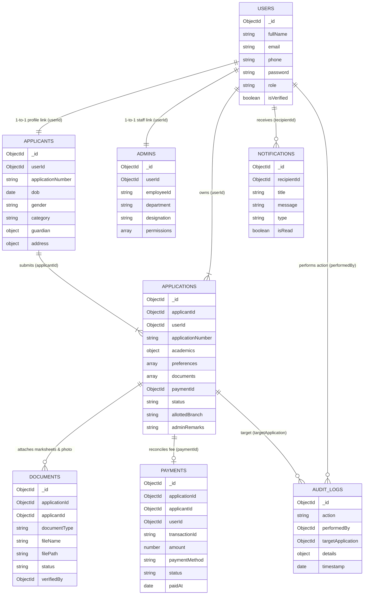

# IEM Admission Portal — MongoDB Database Architecture & Collections

The backend connects to MongoDB via **Mongoose** with a normalized relational schema structure across **8 specialized collections**:

---

## 🗄️ MongoDB Collections & Schema Entity Relationships



---

## 📋 Collection Specifications

| # | Collection Name | Mongoose Model | Primary Relationships (`ref`) | Key Stored Data |
|---|---|---|---|---|
| 1 | **`users`** | [`User.js`](file:///c:/Users/sampr/Downloads/Student%20Management%20System/server/models/User.js) | Base authentication table | Full name, unique email, phone, bcrypt hashed password, roles (`applicant`, `admin`). |
| 2 | **`applicants`** | [`Applicant.js`](file:///c:/Users/sampr/Downloads/Student%20Management%20System/server/models/Applicant.js) | `userId` $\rightarrow$ `User` | Application ID, DOB, gender, category, parent/guardian info, permanent address. |
| 3 | **`applications`** | [`Application.js`](file:///c:/Users/sampr/Downloads/Student%20Management%20System/server/models/Application.js) | `applicantId` $\rightarrow$ `Applicant`<br>`userId` $\rightarrow$ `User`<br>`documents` $\rightarrow$ `[Document]`<br>`paymentId` $\rightarrow$ `Payment` | Class 10/12 marks, auto-calculated PCM %, entrance rank, preferences, review status (`verified`, `seat_allotted`, `correction_required`). |
| 4 | **`documents`** | [`Document.js`](file:///c:/Users/sampr/Downloads/Student%20Management%20System/server/models/Document.js) | `applicationId` $\rightarrow$ `Application`<br>`applicantId` $\rightarrow$ `Applicant`<br>`verifiedBy` $\rightarrow$ `User` | Photo, signature, Class 10/12 marksheets, rank card, file path, size, status (`pending`, `verified`, `correction_required`). |
| 5 | **`payments`** | [`Payment.js`](file:///c:/Users/sampr/Downloads/Student%20Management%20System/server/models/Payment.js) | `applicationId` $\rightarrow$ `Application`<br>`applicantId` $\rightarrow$ `Applicant`<br>`userId` $\rightarrow$ `User` | Unique transaction ID (`TXN-IEM-XXXXXXXX`), amount (₹1,000), payment method (UPI, Card, NetBanking), timestamp. |
| 6 | **`notifications`**| [`Notification.js`](file:///c:/Users/sampr/Downloads/Student%20Management%20System/server/models/Notification.js) | `recipientId` $\rightarrow$ `User` (or `null` for public notices) | Real-time alerts for application submission, fee receipts, seat allotment letters, and resubmission requests. |
| 7 | **`admins`** | [`Admin.js`](file:///c:/Users/sampr/Downloads/Student%20Management%20System/server/models/Admin.js) | `userId` $\rightarrow$ `User` | Official employee ID, department, designation, granular permissions (`verify_documents`, `allot_seats`). |
| 8 | **`auditlogs`** | [`AuditLog.js`](file:///c:/Users/sampr/Downloads/Student%20Management%20System/server/models/AuditLog.js) | `performedBy` $\rightarrow$ `User`<br>`targetApplication` $\rightarrow$ `Application` | Complete compliance log: registrations, logins, status changes, allotment records with timestamps and IP. |

---

## 🧪 Testing the Database Operations

### **Run Automated Schema & Relationship Verification Test**
To run the automated verification test right now:
```powershell
python server/tests/verify_schemas_and_relationships.py
```
**Test Results: 28/28 Tests Passed (100% Pass Rate)**:
- Verified all 8 model files exist and import cleanly.
- Verified all `ObjectId` relational references (`ref: 'User'`, `ref: 'Applicant'`, `ref: 'Document'`, `ref: 'Payment'`).
- Verified Class 12 Science PCM aggregate computation: $\frac{P + C + M}{3} = 92.0\%$.
- Verified admission eligibility threshold ($\ge 60\%$) and rejection of sub-45% aggregates.
- Verified unique Application ID (`IEM-2026-XXXX`) and Transaction ID (`TXN-IEM-XXXXXXXX`) regex patterns.

### **Run Live MongoDB Operations Test (With Node.js & MongoDB Running)**
```powershell
cd server
npm test
```
Tests live document creation, password hashing with bcrypt, cross-collection `populate()`, payment recording, and cleanup.

---

## 🚀 Seeding the 8 Collections with Realistic IEM Data

```powershell
cd server
npm run seed
```
This populates:
1. `courses`: 7 IEM B.Tech, BCA, MCA, and MBA academic programs.
2. `users` & `admins`: Convener Dr. S. Banerjee (`admin.admissions@iemcal.com` / `admin@iem2026`).
3. `users` & `applicants`: Candidate Arindam Mukherjee (`IEM-2026-8492`).
4. `applications`: Application with 92.0% PCM and WBJEE Rank 1,420 (Allotted B.Tech CSE).
5. `documents`: Verified photo, Class 12 marksheet, and WBJEE rank card.
6. `payments`: ₹1,000 paid via UPI (`TXN-IEM-93821039`).
7. `notifications`: Candidate provisional allotment alert & public notices.
8. `auditlogs`: Audit trail for registration, payment, submission, document verification, and seat allotment.
